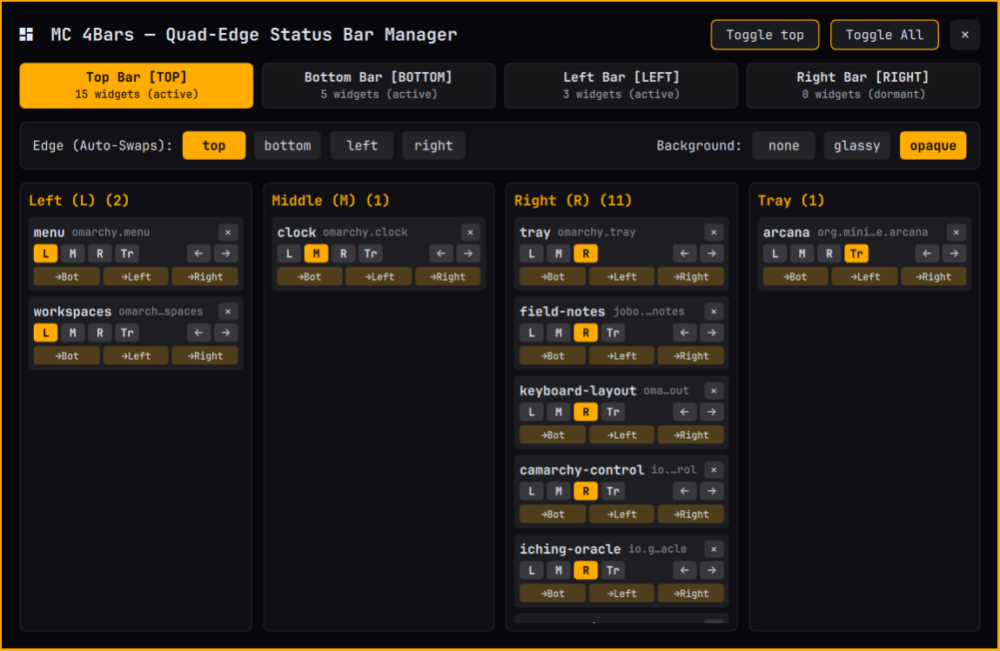
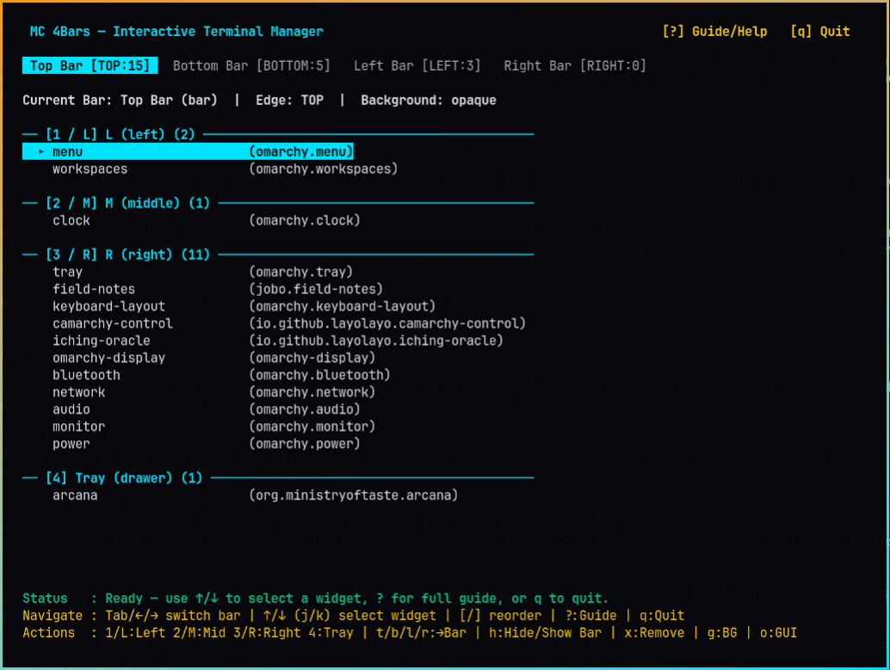

# MC 4Bars (`io.github.layolayo.mc-4bars`)

Quad-edge status bar system for Omarchy Quattro Shell. Host independent status bars across **Top**, **Bottom**, **Left**, and **Right** screen edges with lazy surface instantiation, warm off-screen parking, vertical orientation adaptation, automatic fullscreen hiding, and both a graphical layout manager (GUI) and an interactive terminal user interface (TUI).





---

## Features

- **4 Independent Screen Edges**: Run widgets on the **Top** (`bar`), **Bottom** (`bottomBar`), **Left** (`leftBar`), and **Right** (`rightBar`) screen edges simultaneously.
- **Lazy Instantiation & Warm Off-Screen Parking**: Empty bars consume zero Wayland layer surfaces. Populated bars park warmly off-screen (`exclusiveZone: 0`) when hidden so toggling is instantaneous without destroying widget state.
- **4 Sections per Bar (`L` / `M` / `R` + `Tray`)**: Place any first-party (`omarchy.*`) or third-party bar widget into Left/Top (`L`/`T`), Middle (`M`), Right/Bottom (`R`/`B`), or the expandable `Tray` drawer on any bar.
- **Vertical Bar Adaptation**: Left and Right edge bars automatically adapt horizontal widgets and rotate multi-character text labels by 90 degrees so clocks, workspace indicators, and plugin badges remain readable along vertical edges without clipping.
- **Per-Bar Visibility & Fullscreen Auto-Conceal**:
  - Toggle any individual bar (`top`, `bottom`, `left`, `right`) or all secondary bars at once from the GUI, TUI, CLI, or IPC.
  - **Fullscreen Auto-Conceal**: Automatically parks both the primary Top Bar and all active secondary bars off-screen whenever a window enters fullscreen on that monitor, preventing input bleed-through into fullscreen applications and games, and restores your previous bar visibility state upon exiting fullscreen.
- **Dual Management Interfaces**:
  - **Graphical Layout Manager (`ManagerPanel.qml`)**: Drag-and-drop or click-to-assign widgets across all 4 bars, reorder sections, cycle bar backgrounds (`none`, `glassy`, `opaque`), toggle installed plugins, and hide/show individual edges.
  - **Interactive Curses TUI & CLI (`bin/omarchy-mc-4bars`)**: Launchable directly from the GUI header (**Open TUI** button), right-clicking the bar icon, or running from any terminal.

---

## Requirements

- **Omarchy** with the **Quattro Shell** (`omarchy-shell` / `quickshell`).
- **Python 3** (`/usr/bin/python3`, standard library `curses` module) for the TUI and CLI helper.
- Recommended companion tool: [`omarchy-toggle`](https://github.com/layolayo/omarchy-toggle) for enabling/disabling third-party plugins directly from the manager.

---

## Installation

### Via Omarchy Plugin CLI (Recommended)

```bash
omarchy plugin add https://github.com/layolayo/omarchy-mc-4bars.git --enable
```

Or using `omarchy-shell` directly:

```bash
omarchy-shell plugin install https://github.com/layolayo/omarchy-mc-4bars
```

### Optional: Add CLI / TUI to `$PATH`

The GUI panel (**Open TUI** button) and bar widget right-click action automatically resolve `bin/omarchy-mc-4bars` inside the installed plugin directory, so no manual `$PATH` setup is needed for graphical use. To run `omarchy-mc-4bars` directly from any terminal shell:

```bash
mkdir -p ~/.local/bin
ln -sf ~/.config/omarchy/plugins/io.github.layolayo.mc-4bars/bin/omarchy-mc-4bars ~/.local/bin/omarchy-mc-4bars
```

---

## Usage

### 1. Bar Widget (`BarWidget.qml`)

When placed on a bar, the MC 4Bars icon button supports three mouse actions:
- **Left-click**: Open or close the graphical **MC 4Bars Layout Manager** (`ManagerPanel.qml`).
- **Middle-click**: Toggle visibility (hide/show) of all secondary bars at once.
- **Right-click**: Launch the interactive `omarchy-mc-4bars tui` in a floating terminal window.

### 2. Graphical Layout Manager (`ManagerPanel.qml`)

Open the graphical manager by clicking the bar widget or running:

```bash
omarchy-shell shell toggle io.github.layolayo.mc-4bars "{}"
```

From the GUI you can:
- **Show / Hide Any Bar**: Use the header buttons (`Toggle Top`, `Toggle Bottom`, `Toggle Left`, `Toggle Right`, and `Toggle All`) to hide or show bars immediately.
- **Move & Reorder Widgets**: Drag widgets or use the section controls to move items between `Top`, `Bottom`, `Left`, and `Right` bars and across sections (`L`/`T`, `M`, `R`/`B`, `Tray`).
- **Cycle Bar Backgrounds**: Switch any bar between `none` (transparent), `glassy`, and `opaque`.
- **Open TUI**: Click **Open TUI** in the top-right header to open the interactive curses terminal interface.

### 3. Interactive TUI (`omarchy-mc-4bars tui`)

Launch the TUI from the GUI **Open TUI** button, by right-clicking the bar icon, or from a terminal:

```bash
~/.config/omarchy/plugins/io.github.layolayo.mc-4bars/bin/omarchy-mc-4bars tui
```

#### TUI Keyboard Shortcuts

| Key | Action |
| :--- | :--- |
| `Tab` or `Left` / `Right` | Switch active bar tab (`Top` → `Bottom` → `Left` → `Right`) |
| `Up` / `Down` or `j` / `k` | Select widget on the current bar |
| `1` / `2` / `3` / `4` | Move selected widget to section `1` (`L`/`T`), `2` (`M`), `3` (`R`/`B`), or `4` (`Tray`) |
| `L` / `M` / `R` (or `T` / `M` / `B`) | Move selected widget to Left/Top, Middle, or Right/Bottom section on the current bar |
| `t` / `b` / `l` / `r` | Send selected widget to the `Top`, `Bottom`, `Left`, or `Right` bar |
| `[` / `]` | Reorder selected widget earlier (`[`) or later (`]`) within its current section |
| `h` | Toggle visibility (hide/show) of the currently viewed bar (`Top`, `Bottom`, `Left`, or `Right`) |
| `H` | Toggle visibility (hide/show) of all secondary bars at once |
| `g` | Cycle background style (`none` → `glassy` → `opaque`) for the current bar |
| `x` / `d` / `Del` / `Backspace` | Remove selected widget from the bar (prompts `y`/`n` to confirm) |
| `o` | Open the graphical MC 4Bars Layout Manager (`ManagerPanel.qml`) |
| `?` | Toggle the built-in interactive help screen |
| `q` or `Esc` | Quit the TUI |

### 4. CLI Subcommands & IPC

`omarchy-mc-4bars` provides full CLI subcommands for scripting and Hyprland keybindings:

```bash
# Display all 4 bars and their current widget layouts
omarchy-mc-4bars list

# Open the interactive TUI or graphical manager
omarchy-mc-4bars tui
omarchy-mc-4bars gui

# Move a widget to a specific bar and section (L, M, R, T, B, or tray)
omarchy-mc-4bars top omarchy.workspaces L
omarchy-mc-4bars bottom omarchy.clock M
omarchy-mc-4bars left io.github.layolayo.mc-4bars B
omarchy-mc-4bars move omarchy.system-NowPlaying bottom R --before omarchy.tray

# Hide, show, or toggle a specific bar edge (top, bottom, left, right) or all secondary bars
omarchy-mc-4bars toggle bottom
omarchy-mc-4bars toggle top
omarchy-mc-4bars hide left
omarchy-mc-4bars show left
omarchy-mc-4bars toggle

# Swap the entire widget layout of two edges
omarchy-mc-4bars swap top bottom

# Change bar background style (none, glassy, opaque, cycle)
omarchy-mc-4bars background glassy bottom

# Remove a widget from whichever bar it is on (-y skips confirmation)
omarchy-mc-4bars remove io.github.layolayo.mc-4bars -y

# Clean any uninstalled/invalid widget entries across all 4 bars
omarchy-mc-4bars clean
```

Direct IPC targets via `omarchy-shell`:

```bash
omarchy-shell shell toggle io.github.layolayo.mc-4bars "{}"
omarchy-shell io.github.layolayo.mc-4bars toggle
omarchy-shell io.github.layolayo.mc-4bars toggleEdge bottom
omarchy-shell io.github.layolayo.mc-4bars hideEdge left
omarchy-shell io.github.layolayo.mc-4bars showEdge left
omarchy-shell io.github.layolayo.mc-4bars reloadConfig
```

---

## Configuration & State Storage

- **Bar Layouts**: Stored in `~/.config/omarchy/shell.json` across the `bar` (Top), `bottomBar` (Bottom), `leftBar` (Left), and `rightBar` (Right) objects (`position`, `background`, `autoHide`, and `layout.{left,center,right,tray}`).
- **Visibility State Files**: Synchronised with `~/.local/state/omarchy/toggles/bar-off` (primary Top Bar) and `~/.local/state/omarchy/toggles/mc-4bars-auto-bar-off` (automatic fullscreen conceal state).

---

## Security & Hardening

- **Zero Network Access**: All configuration, state inspection, and IPC operations execute locally.
- **Explicit Binary Path Resolution**: Subprocess invocations in QML and Python resolve Omarchy utilities through `$OMARCHY_PATH/bin` (`~/.local/share/omarchy/bin`) and system binaries via `/usr/bin/...` without `/bin/sh -c` shell interpolation.
- **Plain-Text Label Enforcement**: Dynamic labels in `ManagerPanel.qml` use `textFormat: Text.PlainText` to prevent Qt `AutoText` HTML or remote-image injection from third-party plugin manifests.
- **Bounded File & IPC Reads**: `bin/omarchy-mc-4bars` enforces strict byte caps on `shell.json` (1 MiB), `manifest.json` (64 KiB, ignoring symlinks), and IPC output (256 KiB), with 2.0-second subprocess timeouts and atomic temporary-file writes (`0600` permissions).

---

## Uninstallation

```bash
omarchy plugin remove io.github.layolayo.mc-4bars
```

If you created the optional symlink in `~/.local/bin`:

```bash
rm -f ~/.local/bin/omarchy-mc-4bars
```

---

## Licence

Released under the [MIT Licence](LICENSE).
